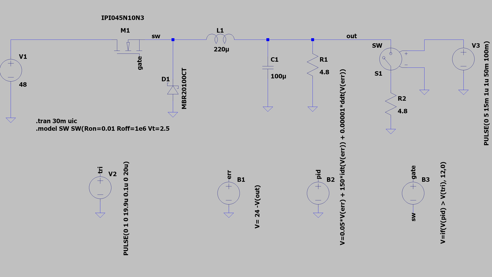
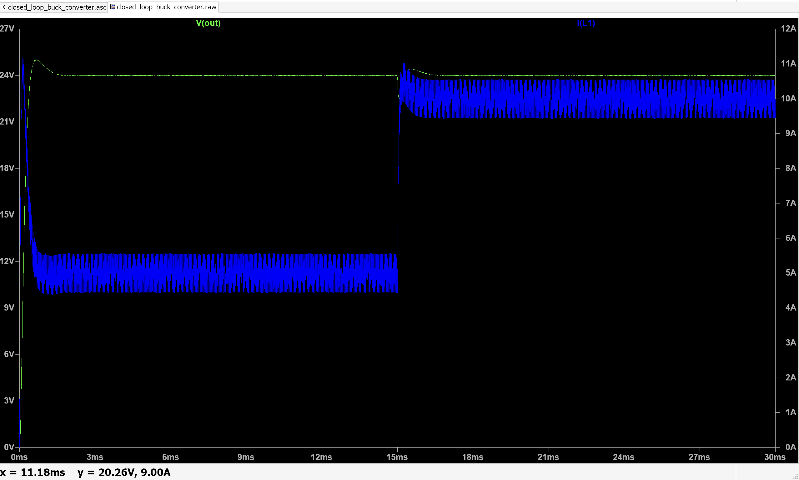

markdown
# Closed-Loop 48V-to-24V DC-DC Buck Converter (LTspice)

Closed-loop PID voltage-mode regulation of a 48 V to 24 V, 50 kHz DC-DC Buck converter simulated in LTspice, tested under a 5 A to 10 A step-load transient.

## Key Circuit Parameters
- **Input Voltage (Vin):** 48 V DC
- **Regulated Output Voltage (Vout):** 24 V DC
- **Switching Frequency (fsw):** 50 kHz
- **Inductor (L1) & Output Capacitor (C1):** 220 uH, 100 uF
- **Power Devices:** N-Channel MOSFET (`IPI045N10N3`) & Schottky Diode (`MBR20100CT`)
- **Transient Test:** Load step from 5 A (4.8 Ohm) to 10 A (2.4 Ohm) at t = 15 ms

## Schematic Diagram

## Load-Step Transient Waveforms

